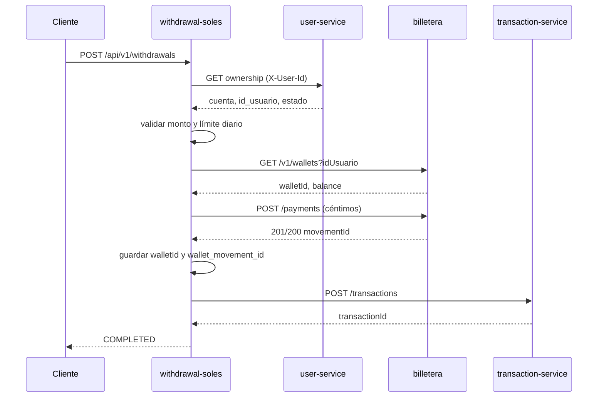

# Acuerdo de integración — retiros en soles y billetera PEN

**Estado:** implementado en el cambio `integrate-pen-wallet-debit` el
2026-11-06 y ampliado en `secure-api-jwt-users-contract` el mismo día. El
contrato publicado de la billetera es la referencia vigente; en particular, el
JWT de servicio usa `sub=retiros`. Desde la ampliación, retiros también exige
JWT en su propia API y valida al dueño con `GET /usuarios/{idUsuario}` antes de
debitar o reversar.

**Alcance:** cómo descuenta el saldo `withdrawal-soles` cuando crea un retiro en
PEN, cómo se identifica al dueño y cómo se convierte el monto.

## Resumen de las tres decisiones

| Punto | Decisión propuesta |
| --- | --- |
| Quién descuenta | `withdrawal-soles` llama a `POST /v1/wallets/{walletId}/payments` |
| Identidad | `user-service` entrega `id_usuario` entero; la billetera usa ese entero |
| Monto | Retiros convierte `"250.00"` a `25000` céntimos antes de llamar |

Sin estas tres decisiones, el retiro puede registrarse y reportarse a
transacciones, pero **el saldo en soles no baja**.

## 1. Quién descuenta el saldo

### Decisión

La billetera es la única dueña del saldo. `withdrawal-soles` debe llamar a:

```http
POST /v1/wallets/{walletId}/payments
Authorization: Bearer <jwt>
Idempotency-Key: <withdrawal-id>
Content-Type: application/json

{ "amount": 25000, "externalReference": "<withdrawal-id>" }
```

`transaction-service` sigue siendo el historial transaccional; no es la fuente
del saldo.

### Flujo propuesto



### Reglas

1. Si la billetera responde `201` o `200`, el saldo ya bajó. Retiros guarda el
   `movementId` como `wallet_movement_id`.
2. Si responde `422` por saldo insuficiente, no se crea movimiento y el retiro
   no se aprueba.
3. Si responde `503`, no se crea movimiento. Se puede reintentar el mismo
   `POST /payments` con la misma `Idempotency-Key` y el mismo cuerpo.
4. Si el débito funciona pero falla `transaction-service`, el retiro queda
   `APPROVED` y se reintenta el reporte. **No se reversa automáticamente**,
   porque el retiro sigue siendo válido.
5. Si el retiro se anula después del débito, se llama a
   `POST /v1/movements/{movementId}/reverse` y se guarda el movimiento de
   reverso.
6. Si el débito funciona pero la persistencia local falla, retiros debe intentar
   el reverso como compensación.

## 2. Cómo se identifica al dueño

### Problema

Retiros usa:

```text
X-User-Id  → UUID
account_id → UUID
```

La billetera usa:

```text
idUsuario → entero (usuario.id_usuario)
walletId  → UUID de la billetera
```

Ninguno de los dos guarda la relación UUID → entero.

### Decisión propuesta

`user-service` es la fuente de verdad de la identidad. Debe exponer el entero
`id_usuario` en el contrato que ya usa retiros:

```http
GET /api/v1/accounts/{account_id}/ownership
X-User-Id: <uuid>
```

Respuesta ampliada:

```json
{
  "account_id": "1c7a5e0e-4f4a-4a1f-9a3e-7b9f0d2a6c11",
  "owner_user_id": "9d1e2f3a-4b5c-6d7e-8f90-1a2b3c4d5e6f",
  "id_usuario": 15,
  "currency": "PEN",
  "status": "ACTIVE",
  "owned": true
}
```

Retiros usa `id_usuario` para:

```http
GET /v1/wallets?idUsuario=15
```

La billetera sigue usando su propio contrato con usuarios:

```http
GET {USERS_SERVICE_URL}/usuarios/{idUsuario}
Authorization: Bearer <jwt sub=billetera-service>
```

Respuesta mínima:

```json
{ "idUsuario": 15, "estado": true }
```

Retiros usa el mismo contrato antes de cada débito y cada reverso. Antes de esta
ampliación solo lo usaba la billetera; ahora la validación es doble y falla
cerrado: `404 USER_NOT_FOUND`, `422 USER_INACTIVE` o `503
DEPENDENCY_UNAVAILABLE`, sin movimiento.

### Por qué no una tabla de configuración

La relación UUID → entero no debe mantenerse a mano en retiros ni en la
billetera. Debe venir de `user-service`, que es el dueño de usuarios y cuentas.
Una tabla local se desincroniza y no escala.

### Alternativa si `user-service` no puede ampliar ownership

Agregar un endpoint de identidad:

```http
GET /api/v1/users/{user_uuid}/wallet-identity
X-User-Id: <uuid>
```

```json
{ "id_usuario": 15, "estado": true }
```

Retiros lo llama después de validar la cuenta. La billetera mantiene su endpoint
`/usuarios/{idUsuario}` para sus propias validaciones.

### Importante

`account_id` no se envía a la billetera. La billetera es por **usuario**, no por
cuenta. Retiros sigue usando `account_id` para titularidad y límite diario.

## 3. Cómo se escribe el monto

### Decisión

Retiros convierte el monto decimal a céntimos antes de llamar:

```text
"250.00" PEN  →  25000 céntimos
```

Reglas:

- El monto de retiros es un string decimal con máximo dos decimales.
- La conversión es exacta: `int(Decimal(amount) * 100)`.
- Se rechaza cualquier monto con más de dos decimales.
- Rango de retiros: `1000` a `500000` céntimos (`10.00` a `5000.00` PEN).
- La billetera nunca recibe floats ni strings decimales.
- `externalReference` del pago es el UUID del retiro (máximo 128).
- `Idempotency-Key` del pago es el UUID del retiro.
- Para el reverso, `Idempotency-Key` es `<withdrawal-id>:reverse`.

## 4. Contrato de usuarios y operación

Hay dos contratos distintos y ambos deben existir:

| Consumidor | Endpoint | Auth | Respuesta |
| --- | --- | --- | --- |
| Retiros | `GET /api/v1/accounts/{account_id}/ownership` | `X-User-Id` | cuenta, dueño, `id_usuario`, estado |
| Retiros y billetera | `GET /usuarios/{idUsuario}` | JWT `sub=billetera-service` | `{idUsuario, estado}` |
| Cliente de retiros | `POST /api/v1/withdrawals` y demás rutas | JWT `sub=retiros` + `X-User-Id` | operación de retiro |

El equipo de usuarios debe entregar:

1. URL pública de su API, accesible desde la EC2 de la billetera.
2. `GET /usuarios/{idUsuario}` con el contrato indicado.
3. `id_usuario` entero en la respuesta de ownership de retiros.
4. Un `idUsuario` de prueba con `estado: true`.

El equipo de billetera debe:

1. Cambiar `USERS_SERVICE_URL` en la EC2 a la URL real.
2. Crear la billetera de prueba.
3. Recargar `1500` céntimos.
4. Entregar `idUsuario`, `walletId`, `balance` y `movementId` del `TOP_UP`.

## 5. Errores que debe devolver retiros

| Situación de billetera | HTTP de retiros | `code` propuesto |
| --- | --- | --- |
| Billetera no existe | 404 | `WALLET_NOT_FOUND` |
| Saldo insuficiente | 422 | `INSUFFICIENT_BALANCE` |
| Usuario inactivo | 422 | `USER_INACTIVE` |
| Conflicto de idempotencia/referencia | 409 | `WALLET_CONFLICT` |
| Billetera o usuarios no disponible | 503 | `DEPENDENCY_UNAVAILABLE` |
| Error de autenticación/configuración JWT | 503 | `WALLET_AUTH_FAILED` |

En todos los casos de error no debe existir débito ni movimiento nuevo.

## 6. Datos que debe guardar retiros

Agregar a `withdrawal_operations`:

- `wallet_user_id` entero.
- `wallet_id` UUID.
- `wallet_movement_id` UUID del débito.
- `wallet_reversal_movement_id` UUID nullable.
- `wallet_debited_at` timestamp nullable.

Migración Alembic necesaria. El `wallet_movement_id` es obligatorio para poder
reversar.

## 7. Criterios de aceptación

1. Un retiro de `"250.00"` descuenta exactamente `25000` céntimos y guarda
   `wallet_movement_id`.
2. Reintentar con la misma `Idempotency-Key` no descuenta dos veces.
3. Saldo insuficiente devuelve `422` y no crea movimiento.
4. Billetera `503` devuelve `503`, no crea movimiento y permite reintentar.
5. Reverso devuelve el monto completo una sola vez; el segundo reverso falla.
6. Un retiro no se marca `COMPLETED` si el débito no se confirmó.
7. El saldo de la billetera y el historial de retiros coinciden para el mismo
   UUID de retiro.

## 8. Decisiones pendientes de aprobación

- [x] Aprobar que `user-service` agregue `id_usuario` a ownership.
- [x] Aprobar que el reporte fallido a transacciones deje el retiro `APPROVED`
      sin reverso automático.
- [x] Aprobar la política de reverso solo cuando el retiro se anule después del
      débito.
- [ ] Confirmar quién crea y recarga la billetera de prueba (billetera o
      depósitos).
- [x] Confirmar la URL pública de usuarios y el `idUsuario` de prueba: la
      billetera publicó `http://18.228.136.200` con los usuarios 15, 16, 17 y 18.
- [x] Adoptar el JWT de servicio (`sub=retiros`) también en la API de retiros.

## 9. Lo que no cambia

- La billetera sigue siendo la dueña del saldo.
- `transaction-service` sigue siendo el historial, no la fuente de saldo.
- Retiros sigue siendo el dueño de la operación de retiro.
- Los montos de la API de retiros siguen siendo decimales; la conversión a
  céntimos ocurre solo en el adaptador de billetera.
- Los errores de retiros siguen usando `{code, message, details}`.
