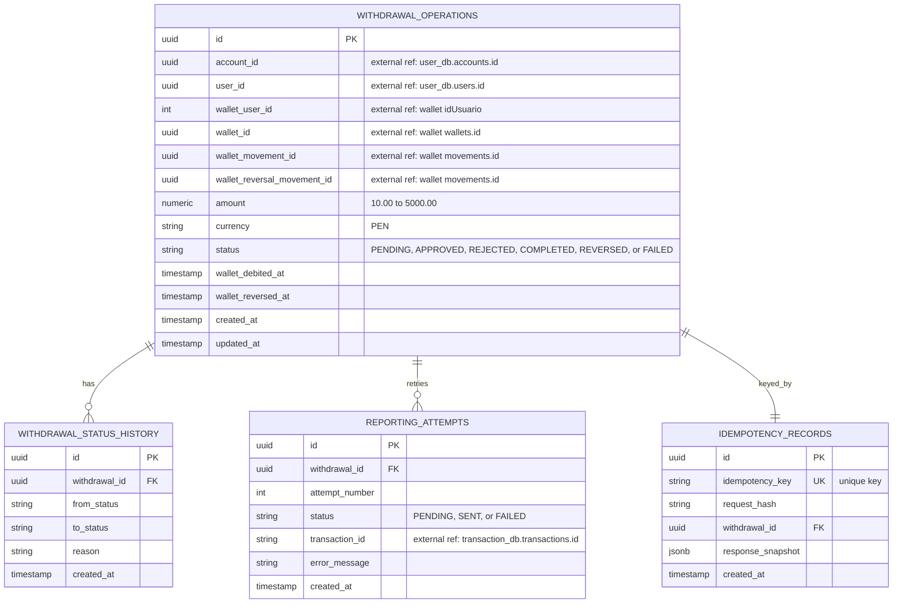
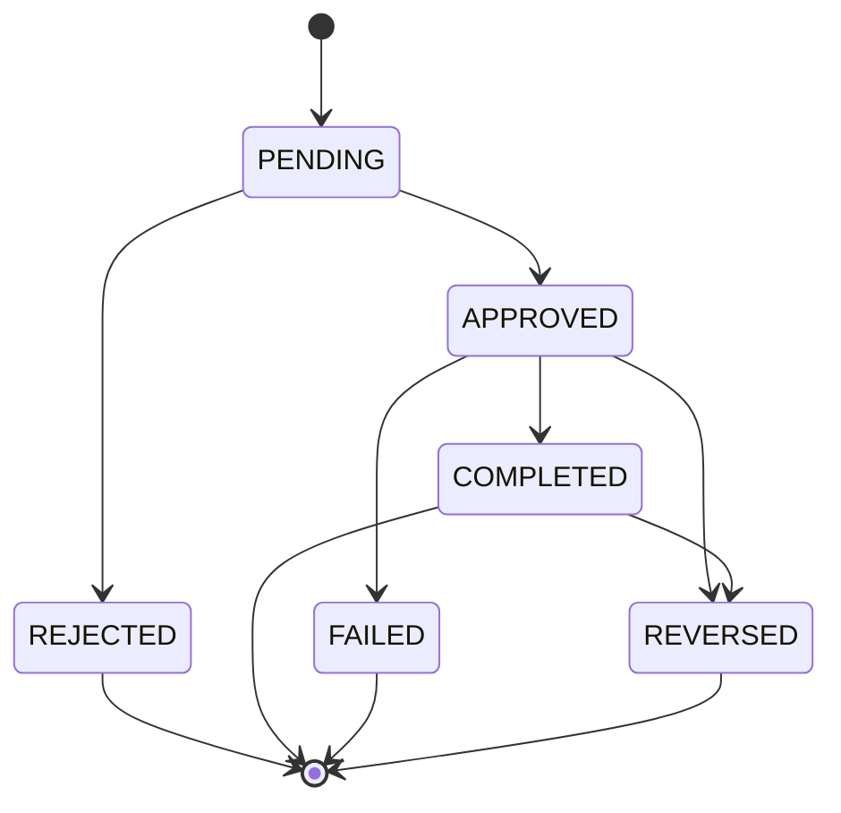

# withdrawal-soles — Microservicio de retiros en soles

PEN withdrawal microservice for the banking platform: it validates ownership,
debits the external PEN wallet, persists the operation lifecycle, and reports
approved withdrawals to the transaction ledger.

> **This repository contains exactly one service: `withdrawal-soles`.**
> The rest of the platform (`user`, `deposit`, `transaction`, and the USD
> variants) is out of scope here and is documented in
> [`openspec/architecture/`](openspec/architecture/).

## Service details

| Item | Value |
| --- | --- |
| Service | `withdrawal-soles` |
| Domain | Withdrawals in Peruvian soles (`PEN`) |
| Owned database | `withdrawal_soles_db` |
| Python package | `withdrawal_soles` |
| Local gateway | `http://localhost:8080` (Traefik) |
| Service port inside Docker | `8000` |
| Swagger UI | `http://localhost:8080/docs` |
| Health check | `http://localhost:8080/health` |

### Responsibilities

- Create PEN withdrawals with `S/ 10.00` minimum, `S/ 5,000.00` maximum, and a
  `S/ 10,000.00` daily accumulated limit per account.
- Validate account ownership, currency, and status through `user-service`.
- Require a service JWT on every business route and `X-User-Id` for the
  end-user identity.
- Validate the wallet owner through `GET /usuarios/{idUsuario}` before a debit
  or a reversal.
- Debit the external PEN wallet, which is the sole owner of the balance, and
  persist the wallet and movement identifiers.
- Reverse the full wallet debit through a compensating movement.
- Enforce `Idempotency-Key` on mutations.
- Persist an auditable lifecycle, idempotency records, and reporting attempts.
- Report approved operations to `transaction-service`.

### Domain rules

- Only `PEN` operations are processed.
- Minimum amount per operation: `S/ 10.00`.
- Maximum amount per operation: `S/ 5,000.00`.
- Daily accumulated limit per account: `S/ 10,000.00`, measured over the
  current `America/Lima` day.
- Statuses: `PENDING`, `APPROVED`, `REJECTED`, `COMPLETED`, `REVERSED`,
  `FAILED`.
- Every approved operation is reported to `transaction-service` over HTTP.

## Tech stack

- Python 3.11+ with FastAPI
- PostgreSQL 15 with SQLAlchemy 2.0 async and Alembic
- Hexagonal layout: `api/`, `application/`, `core/`, `domain/`,
  `infrastructure/`
- Docker and Docker Compose
- Traefik v3 as the API gateway
- pytest and httpx for testing
- GitHub Actions for CI/CD
- Terraform on AWS (EKS) for the target infrastructure

## HTTP contract

Every business request requires `Authorization: Bearer <jwt>` (HS256, issuer
`billetera-dev`, subject `retiros`) and the end-user `X-User-Id` header (a
UUID). Every mutating request also requires `Idempotency-Key`. `/health`,
`/docs`, `/openapi.json`, and `/` are public.

| Method | Path | Headers | Success |
| --- | --- | --- | --- |
| `POST` | `/api/v1/withdrawals` | `Authorization`, `X-User-Id`, `Idempotency-Key` | `201` created; `200` on idempotent replay |
| `GET` | `/api/v1/withdrawals` | `Authorization`, `X-User-Id` | `200` paginated list |
| `GET` | `/api/v1/withdrawals/{id}` | `Authorization`, `X-User-Id` | `200` owned operation |
| `POST` | `/api/v1/withdrawals/{id}/cancel` | `Authorization`, `X-User-Id`, `Idempotency-Key` | `200` rejected operation |
| `POST` | `/api/v1/withdrawals/{id}/reverse` | `Authorization`, `X-User-Id`, `Idempotency-Key`, reason JSON | `200` reversed operation |
| `POST` | `/api/v1/withdrawals/{id}/report` | `Authorization`, `X-User-Id`, `Idempotency-Key` | `200` completed; `202` reporting still pending |
| `GET` | `/health` | none | `200` ready; `503` database unavailable |

Errors use the envelope:

```json
{
  "code": "DAILY_LIMIT_EXCEEDED",
  "message": "The daily withdrawal limit was exceeded.",
  "details": {
    "accumulated": "9900.00",
    "requested": "200.00",
    "limit": "10000.00"
  }
}
```

### Example

```bash
TOKEN=$(.venv/bin/python -c "from withdrawal_soles.infrastructure.service_jwt import sign_service_token; print(sign_service_token(secret='dev-only-change-me', issuer='billetera-dev', subject='retiros', ttl_seconds=3600))")

curl -i -X POST http://localhost:8080/api/v1/withdrawals \
  -H "Authorization: Bearer $TOKEN" \
  -H "Content-Type: application/json" \
  -H "X-User-Id: 9d1e2f3a-4b5c-6d7e-8f90-1a2b3c4d5e6f" \
  -H "Idempotency-Key: demo-1" \
  -d '{"account_id":"1c7a5e0e-4f4a-4a1f-9a3e-7b9f0d2a6c11","amount":"250.00"}'
```

## Entity-relationship diagram

**Owned database:** `withdrawal_soles_db`



### Constraints

- `withdrawal_operations.amount` is between `10.00` and `5000.00` PEN.
- `withdrawal_operations.currency` is restricted to `PEN`.
- `withdrawal_operations.status` is one of `PENDING`, `APPROVED`, `REJECTED`,
  `COMPLETED`, `REVERSED`, or `FAILED`.
- `withdrawal_operations.wallet_user_id`, `wallet_id`, `wallet_movement_id`, and
  `wallet_reversal_movement_id` are external references to the PEN wallet; they
  are stored as values, not database foreign keys.
- `withdrawal_status_history.withdrawal_id` and
  `reporting_attempts.withdrawal_id` reference `withdrawal_operations.id`
  inside the same database.
- `reporting_attempts` is unique on `(withdrawal_id, attempt_number)`.
- `idempotency_records.idempotency_key` is unique.
- `withdrawal_operations.account_id` references `user_db.accounts.id`.
- `withdrawal_operations.user_id` references `user_db.users.id`.
- `reporting_attempts.transaction_id` references
  `transaction_db.transactions.id`.

External references are stored as values, not database foreign keys, because
each service owns its own database and never reads another service's data.

### Status lifecycle



## Local setup

```bash
make install && make verify   # create .venv, run ruff and pytest
docker compose up --build      # PostgreSQL + Traefik + service + local stubs
make contract-check            # HTTP JWT + debit + reversal check
```

Useful commands:

| Command | Purpose |
| --- | --- |
| `make run` | Run uvicorn on `http://localhost:8000` |
| `make test` | Run pytest |
| `make lint` | Run ruff |
| `make migrate` | Apply Alembic migrations |
| `make openapi` | Regenerate `api/openapi.yaml` |
| `make openapi-check` | Fail if `api/openapi.yaml` is stale; validate it against OpenAPI 3 |
| `make simulate` | Simulate the wallet integration |

Settings use the `WITHDRAWAL_SOLES_` prefix; see `.env.example` and
[docs/withdrawal-soles.md](docs/withdrawal-soles.md#configuration).

## AWS infrastructure

The target AWS topology (VPC, EKS cluster, managed node group, ECR repository,
and private RDS PostgreSQL 15) is defined in
[`infra/terraform/`](infra/terraform/README.md). The Kubernetes platform
(Traefik gateway, namespace, Secret, migrations, application, mock, and Ingress)
is defined in [`infra/platform/`](infra/platform/README.md). Static validation
runs without AWS credentials:

```bash
./scripts/verify-terraform.sh
```

Both roots keep state in S3 (`scripts/bootstrap-tf-state.sh`,
`scripts/tf-init.sh`). A credentialed `terraform plan` is expected before any
approved apply of `infra/terraform`. After that, `./scripts/deploy-eks-demo.sh`
builds and pushes the image and applies the platform module. Tear it down with
`./scripts/destroy-eks-demo.sh`.

## CI/CD

[`.github/workflows/verify.yml`](.github/workflows/verify.yml) runs on every
push and pull request:

1. `make lint`, `make test`, and `make openapi-check`.
2. `./init.sh` (harness and OpenSpec) and `./scripts/verify-terraform.sh`.
3. On `main`, when the repository variable `EKS_DEPLOY_ENABLED` is `true`: build
   the image, push it to ECR as `<commit-sha>` and `latest`, apply
   `infra/platform` with that tag, and wait for the `withdrawal-soles` rollout
   and `/health` through the gateway.

In the shared cluster the service calls `billetera-api` at
`http://billetera-api.billetera.svc.cluster.local:3000` with the shared
`JWT_SECRET` and issuer `billetera-dev`. CI never creates the cluster or RDS;
`infra/terraform` stays an operator step.

## Documentation

- [Service reference: URLs, contract, and ERD](service-reference.md)
- [Service guide: setup, migrations, and examples](docs/withdrawal-soles.md)
- [Cross-team integration contract](withdrawal-soles-integration.md)
- [OpenAPI contract](api/openapi.yaml)
- [Postman collection: withdrawal-soles + Billetera PEN](postman/README.md)
- [Architecture ERD](openspec/architecture/erd/withdrawal-soles.md)
- [System architecture](openspec/architecture/README.md)

## Spec-driven workflow

This repository uses the OpenSpec + five-subsystem harness. Read `AGENTS.md`
first, then `context.md` for the project brief.

```bash
./init.sh                 # install, validate harness, validate OpenSpec, run checks
openspec list             # active changes
openspec validate --all --strict
```

The workflow is: propose → review → apply → verify → archive. One active change
at a time.
