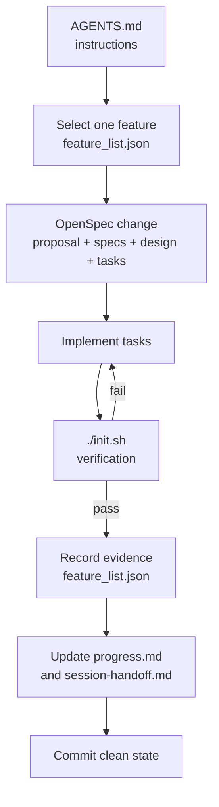

# The Five-Subsystem Harness

A harness is the environment around the model. It decides what the agent
reads, what it may change, how it proves work, and how the next session
continues. This repository implements five subsystems, each with one job.

This model is adapted from the five-subsystem framework in
[Learn Harness Engineering](https://github.com/walkinglabs/learn-harness-engineering).
The artifacts here are the OpenSpec + OpenCode adaptation of that framework.

## At a glance

| Subsystem | Artifacts | Question it answers | Failure it prevents |
| --- | --- | --- | --- |
| Instructions | `AGENTS.md`, `docs/*.md`, `openspec/config.yaml` | What do I do, in what order, and what do I read? | Cold-start confusion and context overload |
| State | `feature_list.json`, `progress.md` | What is done, what is active, what is next? | Lost continuity across sessions |
| Verification | `init.sh`, `scripts/verify.sh`, `scripts/validate-harness.mjs` | How do I prove it works? | Premature "done" claims |
| Scope | `feature_list.json`, `openspec/changes/<change>/tasks.md` | What am I allowed to touch now? | Overreach and half-finished work |
| Session lifecycle | `session-handoff.md`, startup and end-of-session routines | Can the next session restart cleanly? | Fragile handoffs and dirty state |

## 1. Instructions

**Job:** tell the agent what to do, in what order, and what to read before
starting. Not one giant manual — a map the agent navigates on demand.

- `AGENTS.md` is the root router. It holds the startup sequence, the working
  invariants, the definition of done, and the end-of-session routine.
- `docs/harness.md`, `docs/workflow.md`, and `docs/customize.md` hold the
  detail. The agent reads them only when a task needs them.
- `openspec/config.yaml` holds project constraints that OpenSpec injects into
  proposal, spec, design, and task generation.
- `CLAUDE.md` is a one-line pointer for Claude Code. `AGENTS.md` remains the
  single source of truth.

**Rule:** keep the root file short. If a section only applies to one kind of
task, move it into `docs/` and link it.

## 2. State

**Job:** track what has been done, what is in progress, and what is next, in a
form the next session can read without chat history.

- `feature_list.json` is the source of truth for scope and acceptance. Every
  feature has an id, a priority, a user-visible behavior, verification steps,
  evidence, and a status.
- `progress.md` is the session log. It records the current verified state and
  one entry per session: goal, completed work, verification run, evidence,
  commits, risks, and next step.
- The active feature is the single entry with status `in_progress`. Its
  `change` field points at the active directory under `openspec/changes/`.

**Rule:** persist to disk before ending a session. A chat summary is not state.

## 3. Verification

**Job:** make "done" mean "the checks actually ran", not "the code was
written".

- `init.sh` is the standard startup path. It installs dependencies when a
  manifest exists, then delegates to the verification gate.
- `scripts/verify.sh` runs the harness validator, OpenSpec validation, and the
  project's own verification command.
- `scripts/validate-harness.mjs` is a zero-dependency structural check. It
  verifies that all five subsystems are present, that `feature_list.json` is
  coherent, and that a passing feature has evidence.
- `.github/workflows/verify.yml` runs the same gate in CI.

**Rule:** a feature is `passing` only when its verification steps ran and the
result is recorded in the `evidence` array. Never weaken a check to make work
pass.

## 4. Scope

**Job:** keep the agent on one feature at a time, with an explicit definition
of done.

- `feature_list.json` enforces one `in_progress` feature.
- The feature's `change` field ties it to exactly one OpenSpec change.
- `openspec/changes/<change>/tasks.md` is the implementation checklist. The
  agent works through it in order and marks a task complete only after its
  verification.
- `scripts/validate-harness.mjs` rejects multiple active changes and an active
  feature without a matching change.

**Rule:** one feature, one change, one session. If a blocker forces a
supporting fix, keep it narrow and record it in `progress.md`.

## 5. Session lifecycle

**Job:** initialize at the start, clean up at the end, and leave a restart path
for the next session.

Startup:

1. `pwd`
2. Read `progress.md`
3. Read `feature_list.json`
4. `git log --oneline -5`
5. `./init.sh`
6. Fix a broken baseline before starting new work

End of session:

1. Update `progress.md`
2. Update `feature_list.json`
3. Update `session-handoff.md`
4. Run `./init.sh` one last time
5. Commit a safe state
6. Leave no half-finished work undocumented

**Rule:** the next session should be able to continue from repository
artifacts alone. `session-handoff.md` is the compact version of that promise.

## How the subsystems interact

The loop is deliberately small. OpenSpec supplies the plan; the harness
supplies the guardrails and the memory.

## Evidence rules

Evidence is a short, specific statement that a check ran and what it showed.
Good evidence:

- `scripts/validate-harness.mjs: 5/5 subsystems PASS`
- `npm test: 42 passed, 0 failed`
- `GET /health returned 200 {"status":"ok"}`

Bad evidence:

- "Looks good"
- "Tests should pass"
- "Implemented the feature"

If a feature cannot produce evidence, it is not passing. Mark it `blocked` and
record the reason.

## Extending the harness

Add the smallest artifact that addresses the failure you actually see:

- Repeated cold-start confusion → add a startup checklist to `AGENTS.md`.
- Lost context → improve `progress.md` and `session-handoff.md`.
- Premature completion → add a verification step or a test.
- Scope sprawl → tighten the feature list and the change boundary.
- Fragile cleanup → add a clean-state checklist to the end-of-session routine.

Do not solve every problem by adding more text to the root instruction file.
