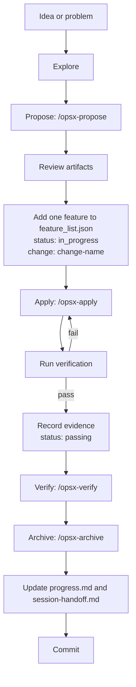

# OpenSpec + Harness Workflow

OpenSpec answers **what should exist and why**. The harness answers **what is
being worked on, how it is verified, and how the next session continues**.
They meet at one point: a single active feature backed by a single active
change.

## The loop



## 1. Explore (optional)

Use `/opsx-explore` when the problem is still unclear. Exploration is a
thinking partner: no project code changes, no commitment to a change.

Skip it when the problem and the desired behavior are already clear.

## 2. Propose

```text
/opsx-propose add-health-endpoint
```

The propose workflow creates a change directory with the artifacts defined by
the `spec-driven` schema:

| Artifact | Path | Purpose |
| --- | --- | --- |
| Proposal | `openspec/changes/<change>/proposal.md` | Why the change exists, what changes, and what is out of scope |
| Specs | `openspec/changes/<change>/specs/<capability>/spec.md` | Behavior contract as a delta |
| Design | `openspec/changes/<change>/design.md` | Technical decisions and trade-offs |
| Tasks | `openspec/changes/<change>/tasks.md` | Ordered implementation checklist |

The propose workflow is a **planning boundary**. It creates artifacts only. Do
not edit project code in the same step. Review the artifacts first.

If the proposal needs a different workflow shape, use `/opsx-new` and
`/opsx-continue` to create the artifacts one at a time.

## 3. Register the feature

Before implementation, add the feature to `feature_list.json`:

```json
{
  "id": "health-001",
  "priority": 1,
  "area": "service-health",
  "title": "Expose a readiness endpoint",
  "user_visible_behavior": "An operator can call GET /health and see whether the service is ready.",
  "status": "in_progress",
  "change": "add-health-endpoint",
  "verification": [
    "Call GET /health while dependencies are available and confirm 200 with {\"status\":\"ok\"}.",
    "Make a required dependency unavailable and confirm 503 with {\"status\":\"unavailable\"}.",
    "Run ./init.sh and confirm it exits 0."
  ],
  "evidence": [],
  "notes": ""
}
```

The validator enforces the link: an `in_progress` feature must name an existing
change with a `tasks.md`. At most one feature may be `in_progress`.

## 4. Apply

```text
/opsx-apply add-health-endpoint
```

The apply workflow reads the change artifacts and works through `tasks.md` in
order. For each task:

1. Implement the task.
2. Run the verification stated in the task.
3. Mark the checkbox only after the verification passes.
4. If a task fails, fix it and rerun. Do not skip ahead.

Keep the change inside the feature scope. If you discover a real blocker,
record it in `progress.md` and mark the feature `blocked` instead of silently
expanding scope.

## 5. Verify

```text
/opsx-verify add-health-endpoint
```

The verify workflow checks the implementation against the proposal, specs,
design, and tasks. It is a review gate, not a replacement for running the
project's tests.

Also run the harness gate:

```bash
./init.sh
```

## 6. Record evidence

A feature becomes `passing` only when the verification steps actually ran.
Record short, specific evidence:

```json
"status": "passing",
"evidence": [
  "GET /health returned 200 {\"status\":\"ok\"}",
  "Dependency failure returned 503 {\"status\":\"unavailable\"}",
  "./init.sh: VERIFICATION PASSED"
]
```

Then update `progress.md` with the session entry.

## 7. Archive

```text
/opsx-archive add-health-endpoint
```

Archiving moves the change into `openspec/changes/archive/` and merges its
spec deltas into `openspec/specs/`. The main specs become the durable system of
record.

Before archiving:

- `./init.sh` passes;
- every task is complete or explicitly moved to a follow-up change;
- `feature_list.json` reflects the final status and evidence;
- `progress.md` records the outcome.

After archiving, clear the feature's `change` field (or keep the archived name
for traceability) and commit.

## Artifact map

| OpenSpec | Harness | Relationship |
| --- | --- | --- |
| `proposal.md` | `feature_list.json` | Why the feature exists and what "done" means |
| `specs/**/spec.md` | `feature_list.json` verification | The behavior contract becomes acceptance checks |
| `design.md` | Implementation notes | Technical decisions, not acceptance criteria |
| `tasks.md` | Active work | The ordered checklist for one session |
| `openspec/specs/` | Repository memory | Durable behavior after archive |
| `openspec/changes/archive/` | `progress.md` | History of what shipped and when |

## Rules

- One active change. One active feature. No parallel scope.
- Propose creates artifacts; apply implements them. Do not mix the two.
- Do not edit `openspec/specs/` directly. Archive a change.
- Do not mark a task complete before its verification runs.
- Do not archive with a failing verification gate.
- Do not rewrite the feature list to hide unfinished work. Mark it `blocked`
  and record why.

## Anti-patterns

| Anti-pattern | Why it fails | Fix |
| --- | --- | --- |
| Starting three changes at once | Context and scope sprawl | Keep one active change |
| Treating `tasks.md` as a wish list | No evidence of completion | Verify each task before checking it |
| Editing archived specs by hand | Specs drift from history | Archive a new change |
| Skipping `./init.sh` because "it worked earlier" | The baseline may be broken | Run the gate every session |
| Using chat as the only state | The next session starts cold | Write `progress.md` and `session-handoff.md` |
