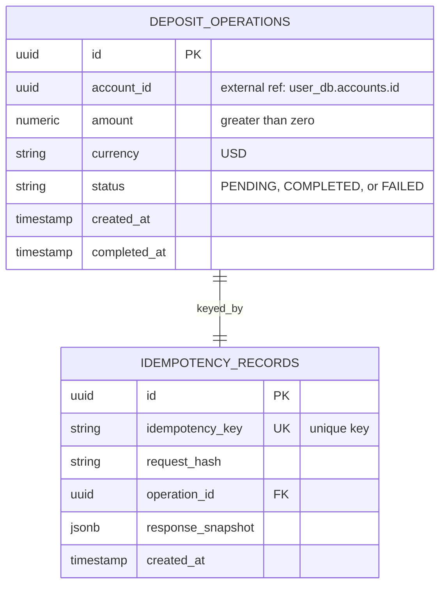

# deposit-dollars ERD

**Owned database:** `deposit_dollars_db`

## Constraints

- `deposit_operations.currency` is restricted to `USD`.
- `deposit_operations.amount` must be greater than zero.
- `deposit_operations.status` is restricted to `PENDING`, `COMPLETED`, or
  `FAILED`.
- `idempotency_records.idempotency_key` is unique.
- `idempotency_records.operation_id` references
  `deposit_operations.id` inside the same database.
- `deposit_operations.account_id` is an external reference to
  `user_db.accounts.id`; it is not a database foreign key.

## Notes

This is the USD equivalent of `deposit-soles`. The schemas are intentionally
separate so each currency evolves and scales independently.
