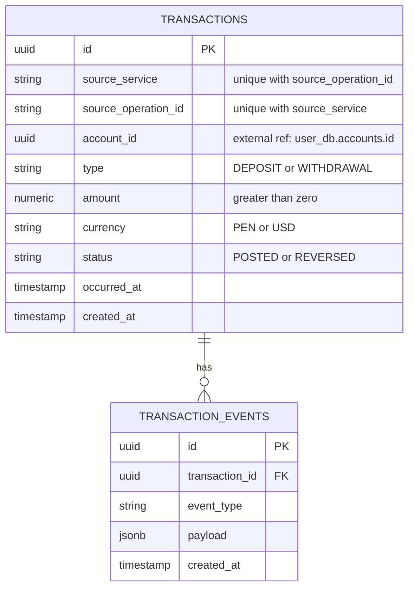

# transaction-service ERD

**Owned database:** `transaction_db`

## Constraints

- `transactions` has a unique constraint on
  `(source_service, source_operation_id)`, making reporting idempotent.
- `transactions.type` is restricted to `DEPOSIT` or `WITHDRAWAL`.
- `transactions.currency` is restricted to `PEN` or `USD`.
- `transactions.amount` must be greater than zero.
- `transactions.status` is restricted to `POSTED` or `REVERSED`.
- `transaction_events.transaction_id` references `transactions.id` inside the
  same database.
- `transactions.account_id` is an external reference to
  `user_db.accounts.id`.

## Notes

The unique source pair is the idempotency boundary: replaying the same report
updates nothing and returns the existing transaction identifier.
