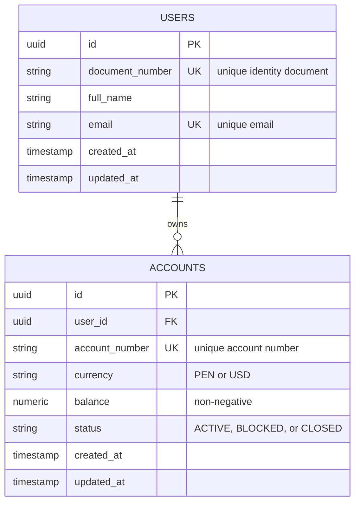

# user-service ERD

**Owned database:** `user_db`

## Constraints

- `users.document_number` and `users.email` are unique.
- `accounts.account_number` is unique.
- `accounts.currency` is restricted to `PEN` or `USD`.
- `accounts.status` is restricted to `ACTIVE`, `BLOCKED`, or `CLOSED`.
- `accounts.balance` must be greater than or equal to zero.
- `accounts.user_id` references `users.id` inside the same database.

## Notes

This service owns customer and account data. Other services reference
`accounts.id` as an external value and must validate it through the
`user-service` API.
