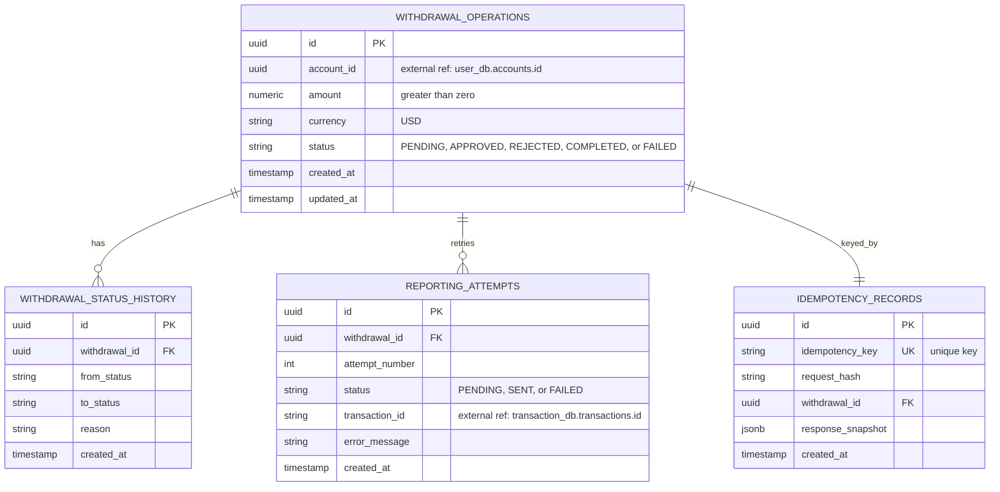

# withdrawal-dollars ERD

**Owned database:** `withdrawal_dollars_db`

## Constraints

- `withdrawal_operations.currency` is restricted to `USD`.
- `withdrawal_operations.amount` must be greater than zero.
- `withdrawal_operations.status` is restricted to `PENDING`, `APPROVED`,
  `REJECTED`, `COMPLETED`, or `FAILED`.
- `withdrawal_status_history` and `reporting_attempts` reference
  `withdrawal_operations.id` inside the same database.
- `reporting_attempts` has a unique constraint on
  `(withdrawal_id, attempt_number)`.
- `idempotency_records.idempotency_key` is unique.
- `withdrawal_operations.account_id` is an external reference to
  `user_db.accounts.id`.
- `reporting_attempts.transaction_id` is an external reference to
  `transaction_db.transactions.id`.

## Notes

This is the USD equivalent of `withdrawal-soles`. Currency-specific limits are
owned by this service and are not read from `withdrawal-soles`.
