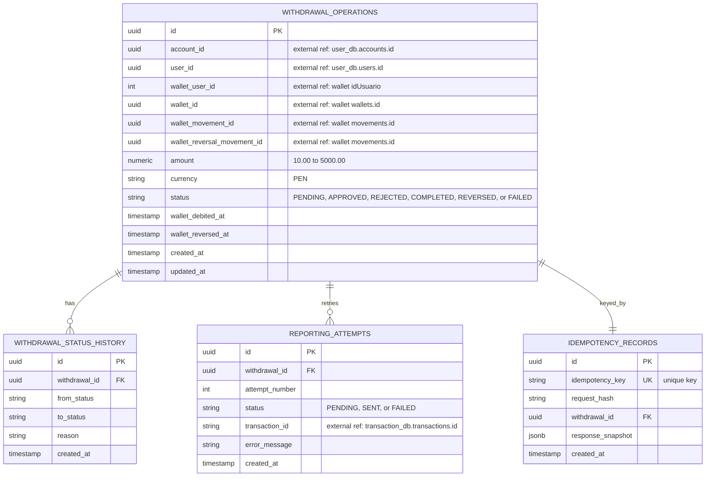
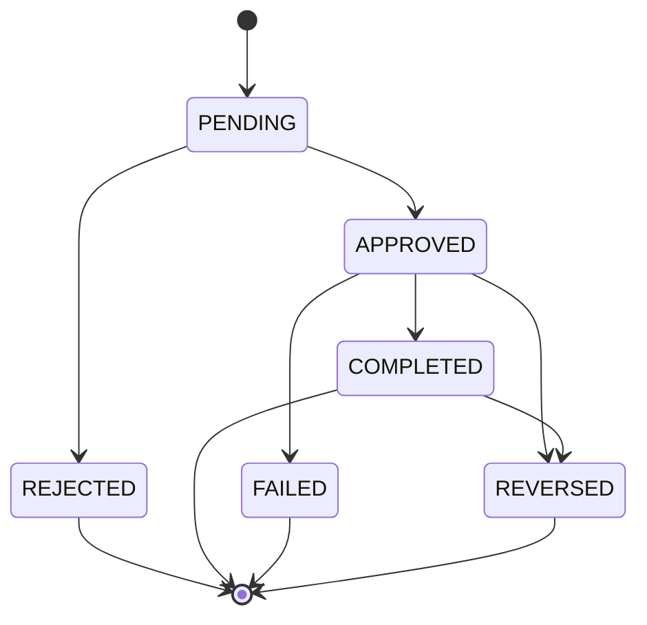

# withdrawal-soles ERD

**Owned database:** `withdrawal_soles_db`

## Constraints

- `withdrawal_operations.amount` must be between `10.00` and `5000.00` PEN.
- `withdrawal_operations.currency` is restricted to `PEN`.
- `withdrawal_operations.status` is restricted to `PENDING`, `APPROVED`,
  `REJECTED`, `COMPLETED`, `REVERSED`, or `FAILED`.
- `withdrawal_operations.wallet_user_id`, `wallet_id`, `wallet_movement_id`, and
  `wallet_reversal_movement_id` are external references to the PEN wallet and
  are stored as values, not database foreign keys.
- `withdrawal_status_history` and `reporting_attempts` reference
  `withdrawal_operations.id` inside the same database.
- `reporting_attempts` has a unique constraint on
  `(withdrawal_id, attempt_number)`.
- `idempotency_records.idempotency_key` is unique.
- `withdrawal_operations.account_id` is an external reference to
  `user_db.accounts.id`.
- `withdrawal_operations.user_id` is an external reference to
  `user_db.users.id`; it stores the authenticated owner for read isolation.
- `reporting_attempts.transaction_id` is an external reference to
  `transaction_db.transactions.id`.

## Status lifecycle

The daily accumulated limit of `S/ 10,000.00` is enforced with a per-account
aggregate over completed and approved withdrawals for the current day.
