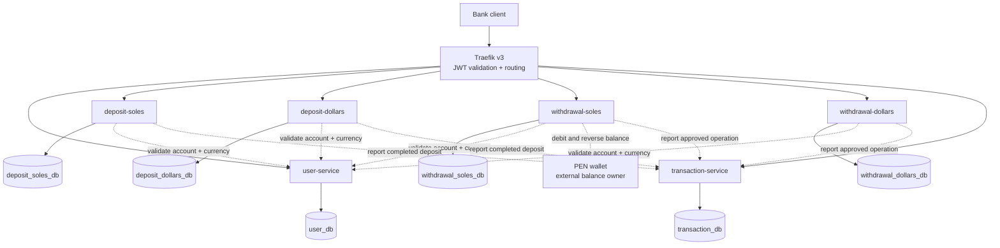

# System Context

## End-to-end diagram

Solid arrows are client traffic through the gateway or service-to-database
access. Dotted arrows are service-to-service HTTP calls that also pass through
Traefik, except the wallet call, which uses the wallet's published base URL
directly.

## Request path: PEN withdrawal

1. The client calls `POST /api/v1/withdrawals` on Traefik with a JWT and an
   `Idempotency-Key`.
2. Traefik validates the JWT, injects `X-User-Id`, and routes to
   `withdrawal-soles`.
3. `withdrawal-soles` calls `GET /api/v1/accounts/{account_id}/ownership` on
   `user-service` through Traefik to confirm ownership, currency `PEN`,
   account status, and the wallet's integer `id_usuario`.
4. `withdrawal-soles` validates domain limits and calls the PEN wallet:
   `GET /v1/wallets?idUsuario` and `POST /v1/wallets/{walletId}/payments` with
   integer cents and the withdrawal UUID as idempotency key and external
   reference.
5. `withdrawal-soles` persists the operation with `wallet_id` and
   `wallet_movement_id` in `withdrawal_soles_db`. A wallet failure aborts the
   request before commit.
6. When the operation reaches `APPROVED` or `COMPLETED`, the service calls
   `POST /api/v1/transactions` on `transaction-service` through Traefik. The
   ledger record is stored in `transaction_db`.
7. If reporting fails, `withdrawal-soles` records a reporting attempt and
   retries idempotently; the wallet debit is not reversed automatically.
8. `POST /api/v1/withdrawals/{id}/reverse` calls
   `POST /v1/movements/{movementId}/reverse`, stores the reversal movement, and
   marks the operation `REVERSED`.

## Deployment topology

### Local

- Docker Compose network.
- Traefik listens on `localhost:8080` and routes to service containers.
- One PostgreSQL 15 container per service database.

### Target: AWS EKS

- VPC with public and private subnets across at least two availability zones.
- EKS managed node group running the service containers.
- Traefik exposed through an AWS load balancer.
- One PostgreSQL 15 instance (or one database per service on managed
  PostgreSQL) reachable only from the cluster security group.
- Container images stored in Amazon ECR.

Terraform for the cluster lives in
[`infra/terraform/`](../../infra/terraform/README.md). The Kubernetes platform,
including Traefik, the application, the dependency stub, and the Ingress, lives
in [`infra/platform/`](../../infra/platform/README.md). Both are verified with
`terraform fmt -check`, `terraform init -backend=false`, `terraform validate`,
and a credentialed plan; applying them requires explicit cost approval.
