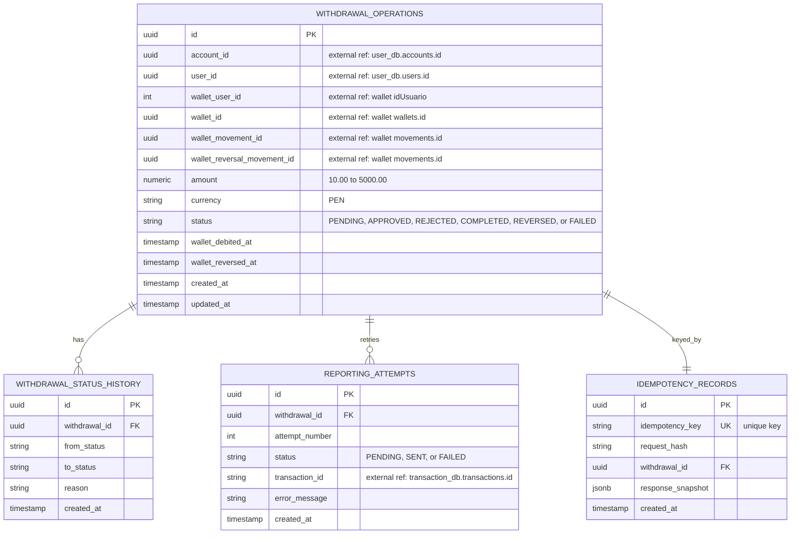
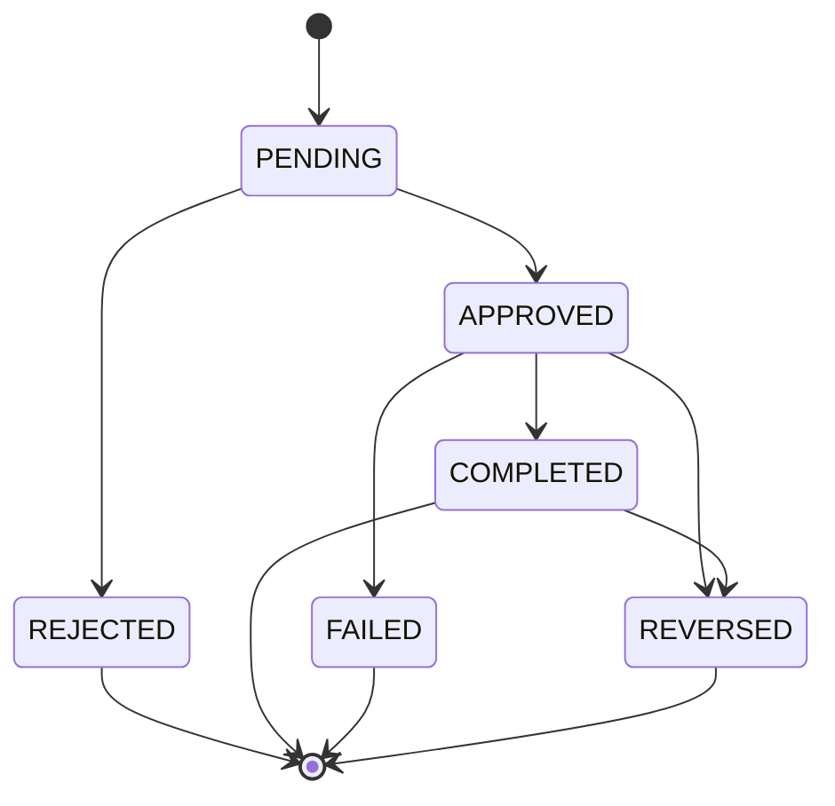

# withdrawal-soles service reference

Quick reference for the PEN withdrawal service: current URLs, HTTP contract,
and the entity-relationship diagram.

## Current status

- The local Docker Compose stack is running and healthy.
- The AWS/EKS practice stack is currently deployed through Terraform.
- The gateway URL is ephemeral; read the current value from the platform
  outputs after every apply.
- The service owns `withdrawal_soles_db` and never reads another service's
  database.

## URLs

### Local (Docker Compose)

| Purpose | URL |
| --- | --- |
| API through Traefik | `http://localhost:8080` |
| Swagger UI | `http://localhost:8080/docs` |
| OpenAPI JSON | `http://localhost:8080/openapi.json` |
| Health check | `http://localhost:8080/health` |
| Service root | `http://localhost:8080/` |
| Withdrawals API | `http://localhost:8080/api/v1/withdrawals` |
| Traefik dashboard | `http://localhost:8081` |
| PostgreSQL | `localhost:55432` |
| PostgreSQL database | `withdrawal_soles_db` |

The service container itself listens on port `8000` inside the Compose network;
Traefik publishes it on port `8080`.

### AWS/EKS (when deployed)

The platform is deployed in two Terraform stages. Read the live gateway URL
from the platform outputs:

```bash
terraform -chdir=infra/platform output -raw gateway_url
terraform -chdir=infra/platform output -raw gateway_hostname
```

The application paths are the same as local, for example:

```text
http://<gateway-hostname>/docs
http://<gateway-hostname>/health
http://<gateway-hostname>/api/v1/withdrawals
```

Current practice gateway:

```text
http://a6c1a4b5ffa8a44808f8a8a0784fe0d7-266125410.us-east-1.elb.amazonaws.com
```

The ECR repository URL comes from the infra outputs:

```bash
terraform -chdir=infra/terraform output -raw ecr_repository_url
```

RDS is private and is not reachable from the public internet.

## HTTP contract

Every business request requires `Authorization: Bearer <jwt>` (HS256, issuer
`billetera-dev`, subject `retiros`) and the end-user `X-User-Id` header (a
UUID). Every mutating request also requires `Idempotency-Key`. `/health`,
`/docs`, `/openapi.json`, and `/` are public.

| Method | Path | Headers | Success |
| --- | --- | --- | --- |
| `POST` | `/api/v1/withdrawals` | `Authorization`, `X-User-Id`, `Idempotency-Key` | `201` created; `200` on idempotent replay |
| `GET` | `/api/v1/withdrawals` | `Authorization`, `X-User-Id` | `200` paginated list |
| `GET` | `/api/v1/withdrawals/{id}` | `Authorization`, `X-User-Id` | `200` owned operation |
| `POST` | `/api/v1/withdrawals/{id}/cancel` | `Authorization`, `X-User-Id`, `Idempotency-Key` | `200` rejected operation |
| `POST` | `/api/v1/withdrawals/{id}/reverse` | `Authorization`, `X-User-Id`, `Idempotency-Key`, reason JSON | `200` reversed operation |
| `POST` | `/api/v1/withdrawals/{id}/report` | `Authorization`, `X-User-Id`, `Idempotency-Key` | `200` completed; `202` reporting still pending |
| `GET` | `/health` | none | `200` ready; `503` database unavailable |

A missing, expired, wrong-issuer, or wrong-subject token returns `401` with
`WWW-Authenticate: Bearer`. A valid token without `X-User-Id` also returns `401`.
Before a debit or reversal, the service validates the wallet owner with
`GET /usuarios/{idUsuario}` and maps `404` to `USER_NOT_FOUND`, an inactive
`estado` to `USER_INACTIVE`, and an unavailable service to `503`.

Errors use the envelope:

```json
{
  "code": "DAILY_LIMIT_EXCEEDED",
  "message": "The daily withdrawal limit was exceeded.",
  "details": {
    "accumulated": "9900.00",
    "requested": "200.00",
    "limit": "10000.00"
  }
}
```

### Example

```bash
TOKEN=$(.venv/bin/python -c "from withdrawal_soles.infrastructure.service_jwt import sign_service_token; print(sign_service_token(secret='dev-only-change-me', issuer='billetera-dev', subject='retiros', ttl_seconds=3600))")

curl -i -X POST http://localhost:8080/api/v1/withdrawals \
  -H "Authorization: Bearer $TOKEN" \
  -H "Content-Type: application/json" \
  -H "X-User-Id: 9d1e2f3a-4b5c-6d7e-8f90-1a2b3c4d5e6f" \
  -H "Idempotency-Key: demo-1" \
  -d '{"account_id":"1c7a5e0e-4f4a-4a1f-9a3e-7b9f0d2a6c11","amount":"250.00"}'
```

## Entity-relationship diagram

**Owned database:** `withdrawal_soles_db`



### Constraints

- `withdrawal_operations.amount` is between `10.00` and `5000.00` PEN.
- `withdrawal_operations.currency` is restricted to `PEN`.
- `withdrawal_operations.status` is one of `PENDING`, `APPROVED`, `REJECTED`,
  `COMPLETED`, `REVERSED`, or `FAILED`.
- `withdrawal_operations.wallet_user_id`, `wallet_id`, `wallet_movement_id`, and
  `wallet_reversal_movement_id` are external references to the PEN wallet; they
  are stored as values, not database foreign keys.
- `withdrawal_status_history.withdrawal_id` and
  `reporting_attempts.withdrawal_id` reference
  `withdrawal_operations.id` inside the same database.
- `reporting_attempts` is unique on `(withdrawal_id, attempt_number)`.
- `idempotency_records.idempotency_key` is unique.
- `withdrawal_operations.account_id` references `user_db.accounts.id`.
- `withdrawal_operations.user_id` references `user_db.users.id`.
- `reporting_attempts.transaction_id` references
  `transaction_db.transactions.id`.

External references are stored as values, not database foreign keys, because
each service owns its own database.

## Status lifecycle



The daily limit of `S/ 10,000.00` is enforced per account over the current
`America/Lima` day, counting pending, approved, and completed operations.

## Related files

- [Cross-team integration contract](withdrawal-soles-integration.md)
- [Wallet integration agreement](ACUERDO-INTEGRACION-BILLETERA.md)
- [OpenAPI contract](openapi.yaml)
- [Service documentation](docs/withdrawal-soles.md)
- [Architecture ERD](openspec/architecture/erd/withdrawal-soles.md)
- [Integration contract](openspec/architecture/integration-contract.md)
- [Terraform infra](infra/terraform/README.md)
- [Terraform platform](infra/platform/README.md)
